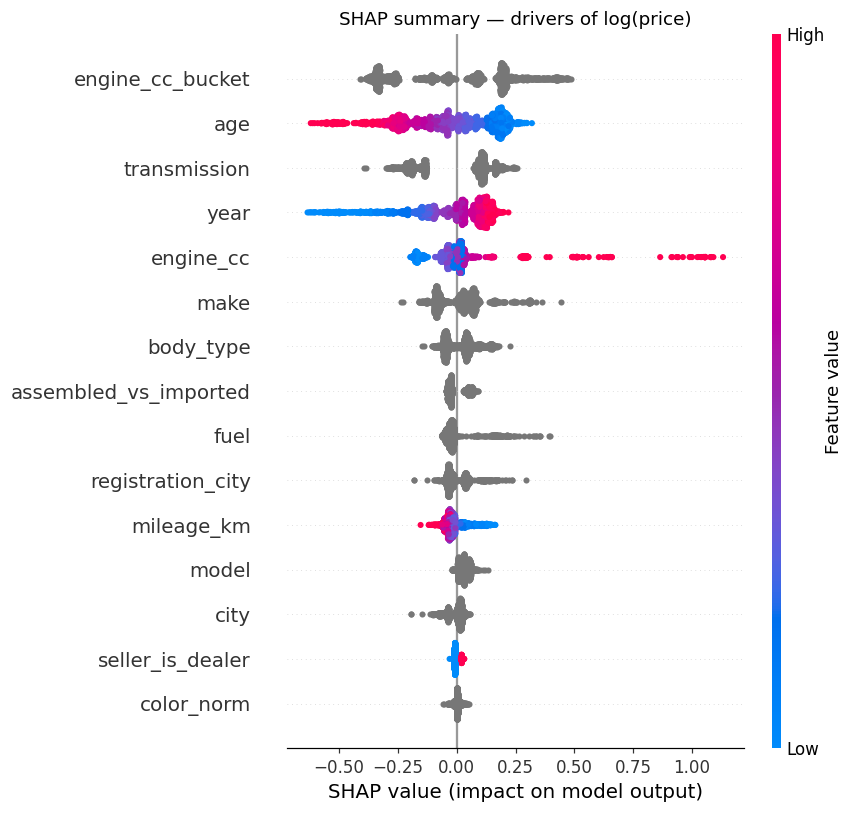
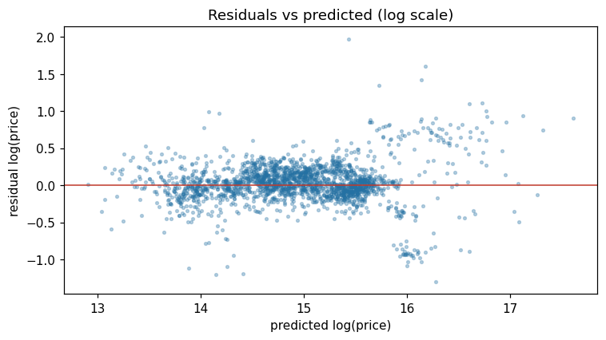
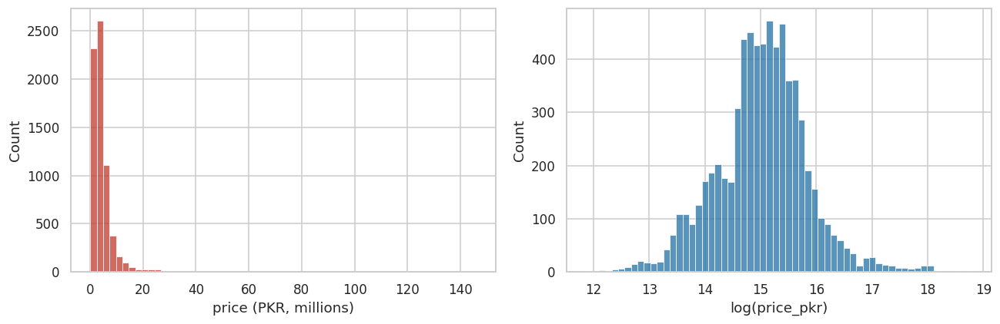

# 🚗 PK Used-Car Valuation

Predicts used-car **asking prices** for the Pakistani market from self-scraped PakWheels
listings — with conformal **prediction intervals**, **SHAP** interpretability, and a
containerised **FastAPI + Streamlit** demo.

> **Model card.** This project demonstrates end-to-end ML engineering discipline —
> self-collected data, leakage-free pipelines, honest evaluation, uncertainty, and a
> shippable service — on a domain a generic Kaggle notebook can't replicate. Squeezing the
> last decimal of R² is *not* the goal; rigor and shippability are.

**Live demo:** _deploy to Hugging Face Spaces or Render and paste the link here_ · **Owner:** Tooba Maqsood

---

## ⚠️ Critical caveat — asking price, not sale price

PakWheels prices are **seller-set asking prices**, not transaction prices, and they are
**biased upward**: sellers copy the prices of comparable listings, which anchors and
inflates the market. **This model predicts asking price, not sale price.** Every number
below is in asking-price terms. Naming this bias and its direction is a deliberate part of
the project — it is the honest way to frame a used-car price model built on listing data.

---

## Results (held-out test set, raw PKR)

Target is `log(price_pkr)`; all metrics are reported back in **raw PKR**. Evaluation uses a
**grouped** train/test split and grouped 5-fold CV — every listing of a given make+model
lands entirely in train or entirely in test, so the model is never scored on a vehicle it
memorised (see *Leakage discipline* below). MAPE matters most for prices.

| Model | CV MAPE | Test MAE | Test RMSE | **Test MAPE** |
|-------|:-------:|:--------:|:---------:|:-------------:|
| **CatBoost** (main) | 22.8% | **PKR 10.1 lac** | 32.4 lac | **17.2%** |
| Linear Regression (baseline) | 29.6% | 11.9 lac | 45.8 lac | 19.0% |
| LightGBM | 27.7% | 13.0 lac | 36.9 lac | 23.0% |

CatBoost is the deployed model and beats a genuine linear baseline. The large absolute
MAE/RMSE is driven by the expensive-car tail (listings run up to PKR 146M); MAPE is the
more meaningful lens and sits at **~17%** on unseen vehicles.

### Prediction intervals (conformal)

Split-conformal intervals around the CatBoost model, calibrated on a held-out grouped
calibration set. The band is additive in log-price, hence **multiplicative in PKR** (wider
for expensive cars).

| Target | Empirical coverage | Mean width |
|:------:|:------------------:|:----------:|
| 90% | **91.2%** | ~PKR 32.6 lac |

The 90% interval contains the true asking price **91.2%** of the time on the held-out set —
essentially perfectly calibrated.

---

## Interpretability (SHAP)

Global drivers of predicted price, from CatBoost's native SHAP values (log-price scale):



Top drivers: **engine-size bucket, age, transmission, year, engine cc, make, body type,
assembled-vs-imported** — all economically sensible for the PK market. Dependence plots for
`age`, `mileage_km`, and `engine_cc` are in [`reports/figures/`](reports/figures/).

### Error analysis (honesty check)

Residuals vs predicted (log scale) and per-segment error show *where* the model is weak:



- **By make:** mass-market makes predict well — Toyota ~15%, Suzuki ~14%, Honda ~15%,
  Daihatsu ~13% MAPE. Rare/exotic makes are poor on few samples — Changan ~132%, Lexus ~44%.
- **By price band:** best in the mid bands (~11–16% MAPE), worst at the cheap and
  expensive extremes.

---

## The data

Self-scraped from PakWheels, **politely and reproducibly** (see [`CLAUDE.md`](./CLAUDE.md),
SPEC §2): `robots.txt` checked before any request, single worker, 3s crawl delay, a
descriptive bot User-Agent, full request logging, checkpoint/resume, and **no stealth** —
a real block stops the crawl rather than evading it. Two-stage: a list pass then a detail
pass, visiting each listing once.

- **7,004** unique listings across **Karachi, Lahore, Islamabad, Rawalpindi** (~1,750 each).
- 98.4% priced (114 "Call for price" listings dropped — no target). Median PKR 3.45M.
- Registration city is a **first-class feature**, kept distinct from listing city (it
  materially affects price/transferability in Pakistan).
- The raw dataset stays **local and gitignored** — it is not redistributed (SPEC §2.1).

The log transform is what makes the target tractable — raw price skew **7.61 → 0.08** under
log:



---

## How it works

```
scrape (2-stage) → listings_full.parquet → feature pipeline → model (log target) → conformal intervals → API/demo
```

- **Target:** `log(price_pkr)`; metrics reported in raw PKR.
- **Features (SPEC §4):** `age`, engine-cc buckets, normalized color, a Dealer/Individual
  flag, and the heuristic `assembled_vs_imported` + confidence. High-cardinality
  make/model/registration_city are handled **natively** by the boosters (no naive one-hot).
- **Leakage discipline (SPEC §5):** every transform (rare-category grouping, imputation,
  encoding) lives in an `sklearn.Pipeline` and is **fit inside CV folds** — never on the
  full dataset. A pytest **leakage guard** fails if any feature encodes the target (it
  catches, e.g., the detail-page price that duplicates the label). CV is **grouped**, not
  naive KFold.
- **Uncertainty (SPEC §6):** split-conformal prediction intervals with reported coverage.
- **Serving (SPEC §8):** FastAPI `/predict` returns a point estimate **and** an interval;
  a Streamlit front end drives it. Experiments tracked with **MLflow**.

**Layer-by-type** `src/` package (not "clean architecture"): `scrape/`, `features/`,
`data/`, `models/`, `evaluation/`, `pipeline.py`. Everything is config-driven via
[`config/config.yaml`](config/config.yaml). 69 tests, `ruff`-clean, CI on every push.

---

## Run it

```bash
make install        # uv sync --dev
make test           # pytest (69 tests)
make lint           # ruff

# Full pipeline (needs the scraped data locally):
make scrape         # two-stage PakWheels scrape (Stage 1 → Stage 2)
make train          # grouped-CV train baseline + LightGBM + CatBoost, log to MLflow
make interpret      # conformal intervals + SHAP + residual diagnostics
make serve-model    # build models/serving_model.joblib

# Serve:
make api            # FastAPI at :8000  (POST /predict)
make demo           # Streamlit demo (loads the model in-process)
```

Example request:

```bash
curl -X POST localhost:8000/predict -H 'content-type: application/json' -d '{
  "make":"toyota","model":"corolla","year":2018,"mileage_km":85000,
  "engine_cc":1300,"transmission":"Automatic","city":"Lahore","registration_city":"Punjab"
}'
# → {"predicted_price_pkr": ~3.97M, "lower_pkr": ~2.79M, "upper_pkr": ~5.65M, "interval_level": 0.9, ...}
```

### Deploy (Hugging Face Spaces / Render)

The image bakes in the serving artifact and binds `$PORT`:

```bash
make serve-model                       # build models/serving_model.joblib first
docker build -t pkcar .
docker run -p 8501:8501 pkcar          # open http://localhost:8501
```

- **Hugging Face Spaces:** create a *Docker* Space, push this repo (with
  `models/serving_model.joblib` committed to the Space), and it serves the Streamlit demo.
- **Render:** new *Web Service* from the Dockerfile; Render sets `$PORT` automatically.

Then paste the URL into the **Live demo** line at the top.

---

## Known limitations

- **Asking price ≠ transaction price.** Prices are anchored upward; treat outputs as
  listing estimates, not resale valuations.
- **Snapshot in time.** A single scrape window; no temporal price-trend modeling (there is
  no valid time axis in the data — `scrape_date` only records when the crawler ran).
- **Four cities only.** Karachi / Lahore / Islamabad / Rawalpindi — not nationally
  representative.
- **`assembled_vs_imported` is heuristic**, with a confidence flag — not an authoritative
  registration record.

---

## Stack

Python 3.11 · uv · pandas · scikit-learn · **LightGBM / CatBoost** · **MLflow** · SHAP ·
FastAPI · Streamlit · Docker · pytest · ruff · GitHub Actions.
See [`SPEC.md`](./SPEC.md) for the full specification.
